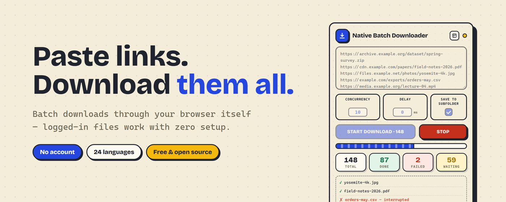
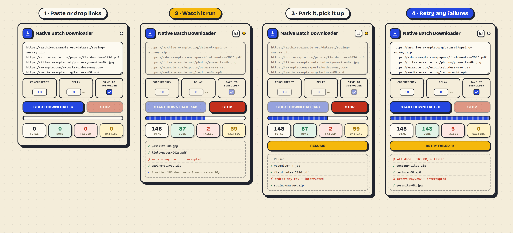
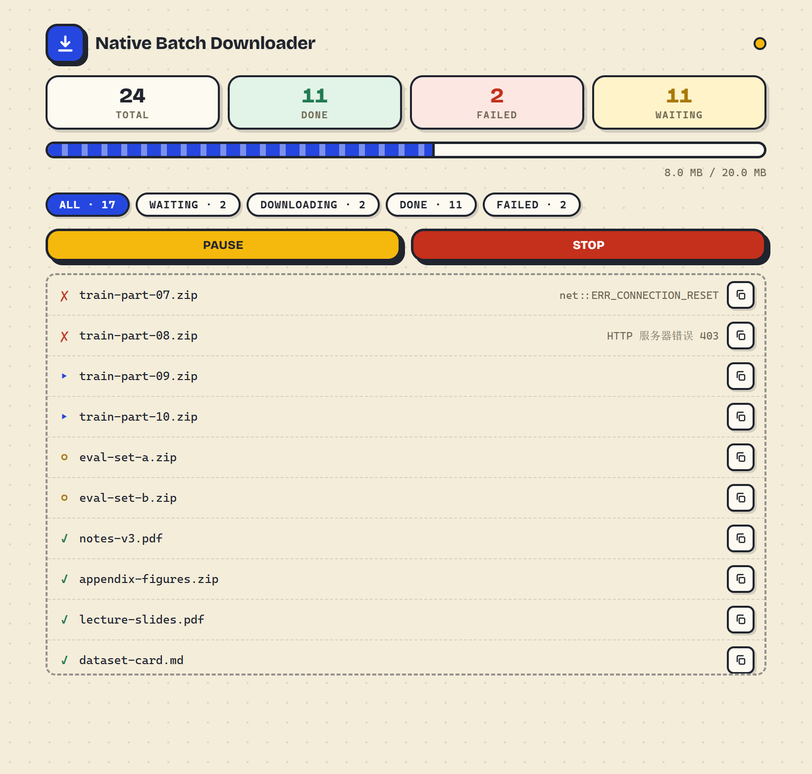

# Native Batch Downloader

> 通过浏览器原生通道批量下载文件的 Chrome 扩展

[English](README.md) · **简体中文**

**[⬇ 从 Chrome 应用商店安装](https://chromewebstore.google.com/detail/native-batch-downloader/fmmihnoplefjcfoggfgpeiomlbmjnfpm)** —— 一键装好、自动更新。需要 Chrome 110+。

把一堆链接粘进去，一次性全部下载。因为它走的是浏览器自己的下载通道——和你手动点链接下载是同一条路——所以**需要登录才能下的文件也能下**，登录状态自动带上，无需任何配置。

## 工作原理

点工具栏图标，把链接一行一个粘进去，点 **开始下载**。队列跑在 Chrome 自己的下载管线上——和你点一个链接时是同一条——所以请求会自动带上 Cookie，不用在任何地方配账号密码。

这同时也划出了边界：一个链接如果在这个浏览器里点了下不下来，放到这儿也一样下不来。下面讲的都是怎么把几百次这样的点击变得可忍受。

## 功能特性

- **需要登录的文件也能下** -- 文件走浏览器自己的下载通道，登录状态自动带上。凡是你登录后能手动下载的，这里都能批量下。
- **并发与间隔控制** -- 可设置并行下载数量（1-200）及每次开始下载之间的最小间隔（毫秒）——包括首批在内的每一次启动都按间隔错开，不会对限速服务器瞬间打满并发。
- **记住你的设置** -- 并发、间隔和子文件夹开关改动即保存（随浏览器账号同步）；超出范围的值离开输入框时就会收拢到 1-200 / 0-10000 毫秒，开始批次时再夹取一次。
- **徽章进度** -- 批量任务运行时工具栏图标显示剩余数量；暂停时显示 `II`，关闭弹窗也能看到状态。
- **失败重试** -- 任务结束后一键把所有失败、中断或被停止丢弃的链接重新入队。
- **批次面板** -- 点弹窗头部的「机房门」图标打开整页视图：每条链接的状态与失败原因（每次显示 400 行，更多可点「显示更多」）、过滤芯片、字节级进度、一键复制链接、保存位置，还有暂停/继续。失败时点「失败」色块直达失败清单。
- **暂停与继续** -- 暂停只停发新任务，在途的下完为止；弹窗和面板都能暂停/继续。
- **右键收集链接** -- 在任何页面右键一条链接选「将链接加入下载批次」，攒够了再点开始。
- **重启不丢批次** -- Chrome 中途重启，所有未完成的链接都会保留（包括正在下载的），重新打开弹窗会询问是否继续。
- **拖入列表文件** -- 把装有链接的 `.txt` 或 `.csv` 文件拖到弹窗上即可载入；CSV 会按列读取其中的 URL，导出的表格也能直接用。
- **整洁的子文件夹** -- 文件保存到下载目录的 `BatchDL/<日期>/` 中（可关闭），200 个文件的批次不会淹没其他下载。面板和完成日志会写清保存位置。
- **实时进度** -- 总计 / 成功 / 失败 / 剩余 四项实时统计，附带进度条。
- **不限文件格式** -- PDF、图片、视频、压缩包、可执行文件——只要是直链，什么都能下。
- **后台持续下载** -- 关闭弹窗不会中断队列；随时重新打开即可继续查看实时进度。
- **智能去重** -- 重复链接只下载一次，并在日志中提示跳过的无效/重复行数。
- **文件名省心** -- 自动保留合适的文件名，无论名字来自链接本身还是服务器。
- **24 种语言** -- AR、BN、DE、EN、ES、FA、FIL、FR、HI、ID、IT、JA、KO、NL、PL、PT-BR、RU、TH、TR、UK、UR、VI、ZH-CN、ZH-TW。

## 安装方法

需要 Chrome 110 或更高版本（已在 manifest 中声明，应用商店不会向更低版本分发）。

**从 Chrome 应用商店安装（推荐）：**

直接前往 [Chrome 应用商店](https://chromewebstore.google.com/detail/native-batch-downloader/fmmihnoplefjcfoggfgpeiomlbmjnfpm) 安装。

**手动安装（开发用）：**

1. 下载或克隆本仓库。
2. 在 Chrome 中打开 `chrome://extensions/`。
3. 打开右上角的 **开发者模式**。
4. 点击 **加载已解压的扩展程序**，选择本项目文件夹。
5. 工具栏出现扩展图标，点击即可打开弹窗。

## 使用方法

1. 点击工具栏中的扩展图标。
2. 在文本框中粘贴下载直链，**每行一个**——或把装有链接的 `.txt`/`.csv` 文件直接拖进弹窗，或在任意页面右键链接选 **将链接加入下载批次**。开始按钮上会实时显示识别到的有效链接数。没点开始就关掉弹窗或重启浏览器也不会丢——重新打开列表还在。
3. 根据需要调整 **并发数**（默认 10）和 **间隔**（默认 0 ms），并选择是否 **存入子文件夹**（默认开启，文件归入 `BatchDL/<日期>/`）。三项设置都会自动记住。
4. 点击 **开始下载**（或在文本框中按 **Ctrl/Cmd+Enter**）。
5. 实时查看日志和统计信息。可关闭弹窗，下载会继续，工具栏图标上的徽章会显示剩余数量。点击 **停止** 可取消任务（含正在进行的下载）。如果 Chrome 中途重启，所有未完成的链接都会保留（包括正在下载的），重新打开弹窗会询问是否继续。
6. 想看全貌？点弹窗头部的 **机房门** 图标（有批次后才会出现）打开批次面板——每条链接的状态与失败原因（每次显示 400 行，更多可点 **显示更多**）、过滤芯片、字节进度、保存位置，还有 **暂停**。弹窗里也能暂停/继续。批次有失败时，点 **失败** 色块直接跳到失败清单，行内一键复制链接。面板第四个统计块算的是「所有还没完成的」（含正在下载的），而 **等待** 筛选芯片只算排队中的链接。
7. 任务结束后若有失败项，会出现 **重试失败项** 按钮——一键把这些链接重新入队。

## 注意事项

### 权限与隐私

扩展只声明三项权限，且**不申请任何网页访问权（host permissions）**：

- **downloads** -- 工具的核心：文件经 Chrome 原生下载通道排队（与你自己点链接是同一条路），登录态因此天然携带。除这些下载外不读取、不写入任何磁盘内容。
- **storage** -- 记住你的设置（`sync`）、跨弹窗关闭和浏览器重启保留未开始的链接列表（`local`）、镜像未完成队列（含正在下载的 URL）以便浏览器重启后询问是否继续（`local`）。全部留在你的浏览器配置里，无账号、无服务端。
- **contextMenus** -- 只添加「将链接加入下载批次」这一个菜单项，且只在链接上出现。Chrome 直接把被点击链接的 URL 交给扩展；此权限不提供任何页面内容访问能力，扩展不读取、不修改任何网页。

### URL 必须是直链

如果一个网站是点按钮后通过 JS 动态生成临时下载地址的（比如网盘的"点击下载"），粘贴页面 URL 进去是没用的，需要拿到实际的文件直链。如果链接返回的是 HTML 网页，批次仍会把它存成文件，但面板和日志会标注「这是网页而不是文件」，提醒你改用文件直链。

### 依赖当前浏览器的登录态

能自动带 Cookie 是因为走的是浏览器自己的请求通道，前提是你在浏览器里已经登录了目标网站。如果目标站需要登录但你没登录，该 403 还是 403。

### Chrome 同域名并发限制

Chrome 对**同一个网站**同时只传约 **6 个文件**，所以即使你设并发 100，同站下载实际同时在传的也就 6 个左右，其余排队等候。从多个不同网站下载则没有这个瓶颈。

### 危险文件类型会触发 Chrome 警告

`.exe`、`.bat` 等可执行文件可能触发 Chrome 内置安全提示，会打断自动下载流程。任何扩展都无法绕过这一限制——这是 Chrome 的安全规则，走任何下载通道都一样。

**怎么办**：别把可执行文件混进大批量里。单独开一个小批次、逐个确认提示即可——批量拉二进制文件正是这道检查最该起作用的场景。

在 `chrome://settings/security` 里把安全浏览关掉确实能去掉提示，但它关掉的是**你全部浏览行为**的钓鱼与恶意软件防护，不只是这一次下载。为省几次点击不值当。

PDF 等常规文档类型完全不受影响，直接用就行。

### 大间隔 + 关闭弹窗

扩展的后台进程在空闲一段时间后可能被 Chrome 暂停。如果你设了较大的 **间隔**（比如好几秒）并关闭了弹窗，暂停可能正好落在等待间隙——没有正在进行的下载来唤醒它，任务会静默停住。重新打开弹窗即可自动恢复。如果保持弹窗打开、或把间隔设为 0，则不会出现这种情况。

## 开发说明

本扩展无构建步骤——纯 HTML/CSS/JS，直接「加载已解压的扩展程序」即可。

- 跑行为测试（headless Chrome 经 CDP 驱动）：`node scripts/run-tests.mjs`
- 修改任何语言的 `title`/`start`/`stop`/`retryFailed`/`pause`/`resume`/`resumeDismiss` 消息或新增语言后，需重新生成打包的展示字体子集：先 `pip install fonttools brotli`，再 `python scripts/subset-display-fonts.py`（缺字会直接报错）。`python scripts/subset-display-fonts.py --check` 用于校验已提交的字体是否仍覆盖这些文案。
- 生成商店上传包：`python scripts/package.py`

## 关于 365 开源计划

[365 开源计划](https://github.com/rockbenben/365opensource) 的第 **#001** 个项目——一个人 + AI，一年 300+ 个开源项目。

[提交你的需求 →](https://365.aishort.top/) · [Discord](https://discord.gg/PZTQfJ4GjX) · [Telegram](https://t.me/aishort_top)
